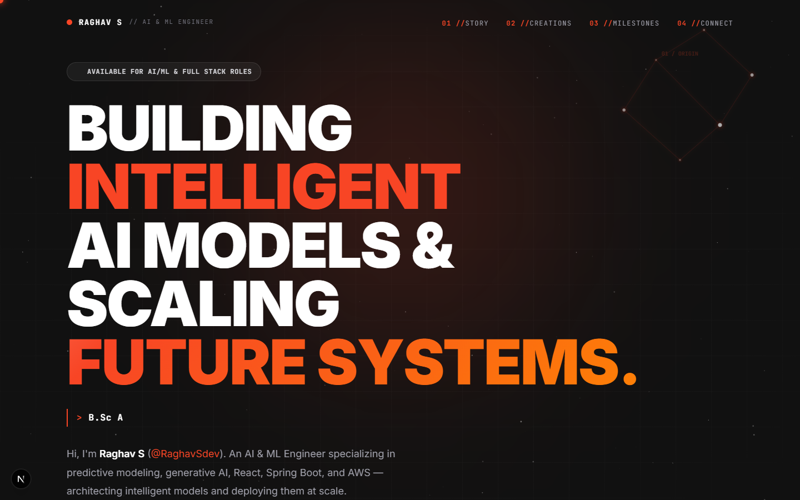
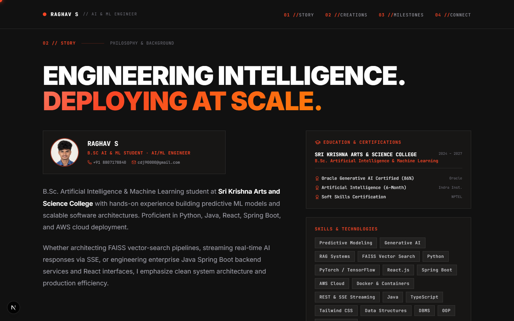
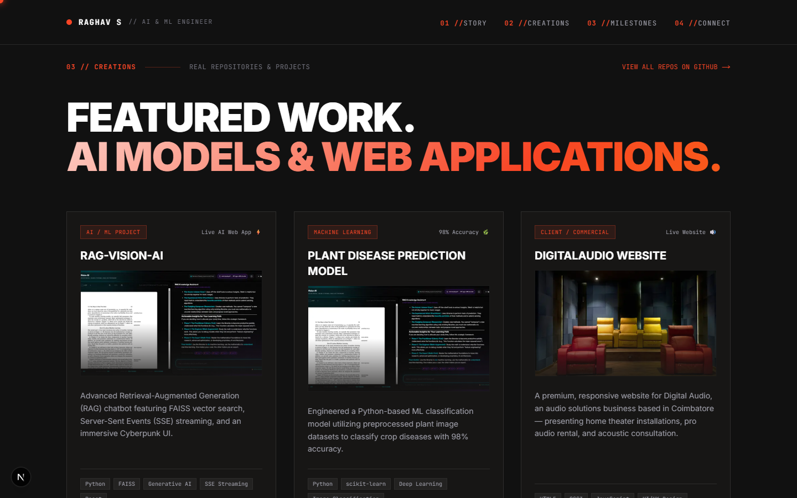
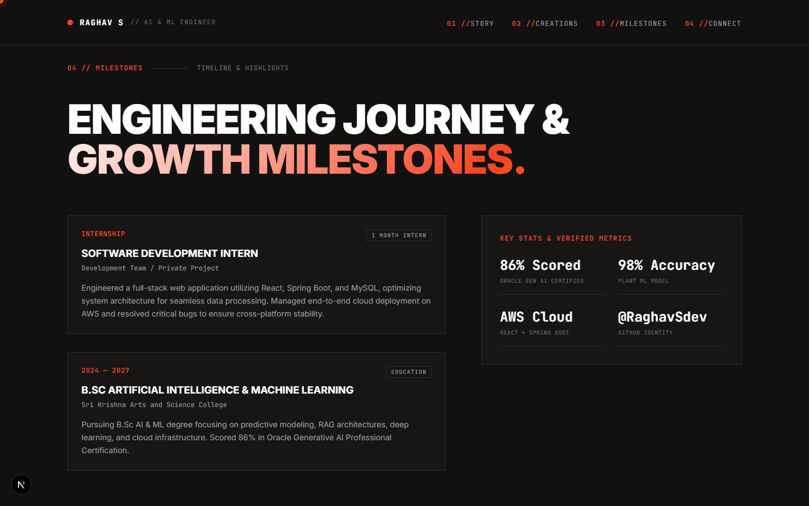
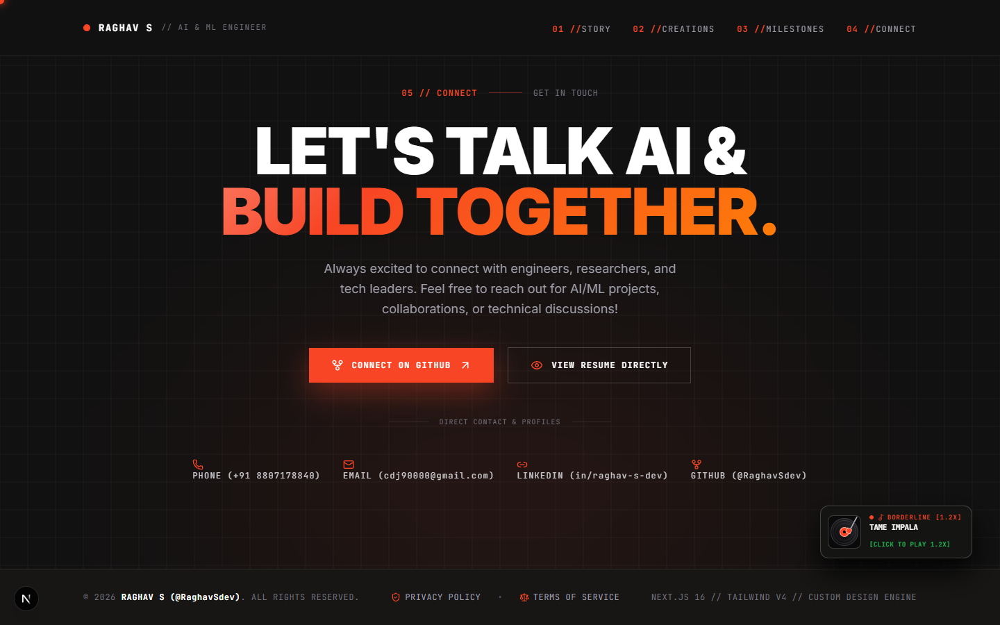
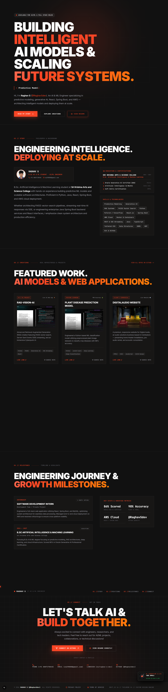

<div align="center">

  <!-- Animated Typing Header Banner -->
  <a href="https://github.com/RaghavSdev/portfolio">
    
  </a>

  <p align="center">
    <strong>B.Sc. Artificial Intelligence & Machine Learning · Predictive Modeling · RAG Architect · AWS Cloud</strong>
  </p>

  <!-- Glowing Shields Badges -->
  <p align="center">
    <a href="https://nextjs.org/"></a>
    <a href="https://tailwindcss.com/"></a>
    <a href="https://www.typescriptlang.org/"></a>
    <a href="https://python.org"></a>
    <a href="https://aws.amazon.com"></a>
    <a href="https://oracle.com"></a>
  </p>

  <!-- Animated Wave Line Divider -->
  
</div>

<br />

## 📸 Real Live Portfolio Walkthrough (Original Screenshots)

Below are the **real live original screenshots** captured directly from the running website, section-by-section in sequential order:

---

### 1️⃣ Hero Section & Interactive Controls
> *Kinetic line mask headline, dynamic typewriter roles, status badge, and View Resume in-app modal launcher.*
<p align="center">
  
</p>

---

### 2️⃣ Story & About Section
> *Profile card, direct contact (Phone: +91 8807178840, Email: cdj90000@gmail.com), education at Sri Krishna College, and Oracle 86% Gen AI Certification card.*
<p align="center">
  
</p>

---

### 3️⃣ Creations & Featured AI Projects Grid
> *Hardware-accelerated 3D tilt cards showcasing RAG-Vision-AI, Plant Disease Prediction (98%), Placement Management System, Student Grade Prediction, and DigitalAudio.*
<p align="center">
  
</p>

---

### 4️⃣ Milestones & Engineering Experience
> *Software Development Intern timeline (React, Spring Boot, MySQL, AWS deployment) and verified metrics grid.*
<p align="center">
  
</p>

---

### 5️⃣ Connect Hub, Light-Up Matrix Background & Vinyl Turntable Player
> *Interactive 40px grid matrix lighting up with neon flame trail splashes (`#f84525`) on hover, paired with the side-docked Vinyl Turntable Player playing Borderline by Tame Impala (1.2x speed).*
<p align="center">
  
</p>

---

### 6️⃣ Complete Full Page Overview
> *Full high-resolution vertical overview of the entire portfolio application.*
<p align="center">
  
</p>

<br />

<!-- Animated Flame Divider -->


## ✨ Key Technical Innovations

| Interactive Component | File Location | Engineering Highlights |
| :--- | :--- | :--- |
| **🕹️ 120fps 3D Tilt Cards** | `src/components/Effects.tsx` | Hardware-accelerated direct mouse-tracking 3D tilt with zero latency and cubic-bezier spring return. |
| **🌌 Constellation Starfield** | `src/components/ConstellationCanvas.tsx` | Dynamic particle constellation starfield background mapped across page sections. |
| **🎆 Light-Up Matrix Grid** | `src/components/InteractiveBackgroundGrid.tsx` | Canvas 2D grid matrix lighting up with neon flame trail splashes (`#f84525`) behind cursor. |
| **🎶 Vinyl Turntable Player** | `src/components/VinylTurntablePlayer.tsx` | Side-docked vinyl player playing *Borderline by Tame Impala* (1.2x) with tonearm needle & spinning disc. |
| **📄 In-App Resume Viewer** | `src/components/ResumeModal.tsx` | Interactive PDF viewer modal for `raghav_s_resume.pdf` with full-screen reading. |

<br />

<!-- Animated GitHub Stats Cards -->
<div align="center">
  <h2>📊 GitHub Stats & Activity</h2>
  
  <p align="center">
    
    &nbsp;
    
  </p>
</div>

<br />

<!-- Animated Wave Line Divider -->


## 🎓 Education & Verified Certifications

* **Sri Krishna Arts and Science College** (Aug 2024 – May 2027) — *B.Sc. Artificial Intelligence & Machine Learning*
* **Oracle Generative AI Professional Certified** (*Scored 86%*) — Oracle
* **Artificial Intelligence (6-Month Diploma)** — Indra Institute of Education
* **Soft Skills Certification** — NPTEL

<br />

## 💻 Local Setup & Installation

```bash
# 1. Clone repository
git clone https://github.com/RaghavSdev/portfolio.git

# 2. Navigate into project
cd portfolio

# 3. Install dependencies
npm install

# 4. Start Next.js development server
npm run dev
```

Open [http://localhost:3000](http://localhost:3000) to view the application in local development mode.

<br />

<!-- Animated Footer Banner -->
<div align="center">
  

  <p align="center">
    <strong>Raghav S</strong> · <a href="mailto:cdj90000@gmail.com">cdj90000@gmail.com</a> · <a href="tel:+918807178840">+91 8807178840</a> · <a href="https://www.linkedin.com/in/raghav-s-dev">LinkedIn</a> · <a href="https://github.com/RaghavSdev">GitHub</a>
  </p>
</div>
